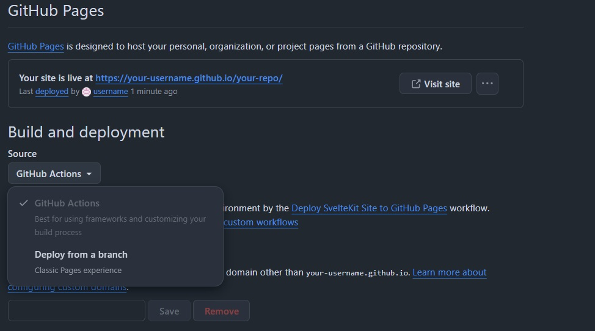

# Open Portfolio

**[View the live portfolio →](https://andesprit.com/open-portfolio/)**

Build a polished portfolio from one readable YAML file. Open Portfolio is a
SvelteKit template for developers and technical professionals who want a fast,
customizable portfolio without rebuilding the same site from scratch.

[Report an issue](https://github.com/Andesprit/open-portfolio/issues) ·
[Contribute](#contributing)

## Why Open Portfolio

- **One YAML config:** edit your profile, experience, skills, links, and section
  order in `src/content/data/portfolio-data.yaml`.
- **Markdown projects and posts:** add long-form work without touching a
  component.
- **Eight included themes:** choose from four light and four dark variants.
- **Flexible sections:** combine simple cards, linked cards, skill groups, and
  Markdown-backed collections.
- **Static and responsive:** SvelteKit generates a fast site that works across
  desktop, tablet, and mobile.
- **GitHub Pages ready:** every push to `main` validates, builds, and deploys the
  portfolio automatically.

## Quick start

You need [Node.js](https://nodejs.org/) 24 LTS (the version in `.nvmrc`, also
used by the GitHub Pages workflow), npm and Git.

### 1. Get the code

- **Just trying it locally?** Clone the template:

  ```bash
  git clone https://github.com/Andesprit/open-portfolio.git
  cd open-portfolio
  ```

- **Publishing your own portfolio?** Click **Fork** on [Andesprit/open-portfolio](https://github.com/Andesprit/open-portfolio), then clone your copy:

  ```bash
  git clone https://github.com/your-username/your-repository-name.git
  cd your-repository-name
  ```

  Your clone already pushes to your repository, so you do not need `git remote add`.

### 2. Install

```bash
npm ci
```

The first install downloads about 200 packages and can take several minutes. It succeeded if it prints `added ... packages` and no `npm error` lines. The lines after it do not mean it failed: a vulnerability count from `npm audit`, `npm warn install-scripts` (or `npm warn allow-scripts`) about esbuild, fsevents and svelte-preprocess, whose install scripts the site does not need, and sometimes an `npm notice` about a newer npm. Do not run `npm audit fix --force`; it can upgrade packages past the versions this template is tested with.

### 3. Personalize and watch it live

```bash
npm run dev
```

Open the address it prints (usually `http://localhost:5173/`). Development always runs at the root `/`, whatever `basePath` says.

- Replace the sample content in `src/content/data/portfolio-data.yaml`, starting with `settings.name`; the page updates when you save.
- Edit or add an entry, for example `src/content/projects/open-portfolio.md` (see [Add projects and custom pages](#add-projects-and-custom-pages)).
- Put images in `static/images/`, icons in `static/icons/` and your resume at `static/CV.pdf`.

Problems in your YAML or Markdown appear as a notice on the page; see [Configuration feedback](#configuration-feedback).

### 4. Check your setup

```bash
npm run doctor
```

It reads your files without changing anything. It checks that the packages are installed, that `portfolio-data.yaml` is valid YAML with `settings`, `sections` and `social`, and that `settings.basePath` has the right shape, and it lists your content warnings. When something blocks the build, it names the file, key or command that fixes it and exits with an error. It does not build or deploy; `npm run build` reports broken page links.

### 5. Build and preview the real site

Set `settings.basePath` to where the site will live:

| Your site address | `basePath` |
| --- | --- |
| `https://your-username.github.io/` (a repository named `your-username.github.io`) | `""` |
| A custom domain, such as `https://example.com/` | `""` |
| `https://your-username.github.io/your-repository-name/` (any other repository) | `/your-repository-name` |

Write the quotes in `basePath: ""`. A `basePath:` with nothing after it means null in YAML and stops the build; `npm run doctor` tells you.

Then:

```bash
npm run build
npm run preview
```

Open `http://localhost:4173` followed by your `basePath` and `/`, for example `http://localhost:4173/open-portfolio/` with the sample `/open-portfolio`, or `http://localhost:4173/` with `""`. `npm run doctor` prints this address for you. `4173` is the default port; if Vite prints another address, use that one. The root `/` shows "not found" when `basePath` is set; that is expected.

When the preview looks right, follow [Deploy to GitHub Pages](#deploy-to-github-pages). A working preview does not prove that GitHub will deploy it; check the Actions tab after you push.

## Configure your portfolio

The YAML file has three top-level groups:

```yaml
settings:
  name: Your Name
  title: Your Role
  bio: A short introduction.
  theme: ocean-dark
  basePath: /your-repository-name
  potrait_image: images/your-photo.jpg
  expertises:
    - TypeScript
    - Product engineering
  cards_before_pagination: 3

sections:
  - title: Experience
    type: cards_with_link
    content:
      - title: Senior Engineer
        organization: Example Company
        date: 2023 - Present
        description: What you built and why it mattered.
        link: https://example.com

social:
  - name: Github
    link: https://github.com/your-username
    icon: icons/github-icon.svg
```

### Settings

| Field                     | Purpose                                                |
| ------------------------- | ------------------------------------------------------ |
| `name`                    | Your name in the navigation, profile, and footer       |
| `title`                   | Your professional role                                 |
| `bio`                     | A short biography with Markdown support                |
| `theme`                   | One of the included theme names                        |
| `basePath`                | `""` for a site at the root of its address, or a repository path such as `/portfolio` |
| `potrait_image`           | Profile image path under `static/`                     |
| `expertises`              | Skills displayed near your introduction                |
| `cards_before_pagination` | Initial number of cards per paginated section          |

Available themes are `light`, `ocean-light`, `forest-light`, `sunset-light`,
`dark`, `ocean-dark`, `forest-dark`, and `sunset-dark`.

`basePath` is optional and defaults to `""`; development ignores it and always
runs at `/`. A repository path needs a leading `/` and no trailing `/`. See the
table in [Build and preview the real site](#5-build-and-preview-the-real-site);
`npm run doctor` checks the shape.

### Section types

Open Portfolio includes four section layouts:

- `cards`: compact entries for certifications, awards, and publications.
- `cards_with_link`: descriptive entries with a destination, useful for
  experience and education.
- `cards_with_icons`: named skill groups with icons and tags.
- `cards_outside`: cards generated from Markdown files in a configured folder.

Reorder the entries under `sections` to reorder the page. Remove a section to
hide it, or add another section using one of the supported types.

### Configuration feedback

`npm run dev` and `npm run build` check `src/content/data/portfolio-data.yaml` for unsupported themes or card types, missing owner names or section titles, duplicate section anchors, likely key typos, missing markdown folders, and missing local images or icons in `static/`. Messages name the YAML field, its value, and a suggested fix. For example, `settings.portrait_image` suggests the existing key `potrait_image`; keep that spelling for compatibility.

Markdown frontmatter is checked too; see [Fixing frontmatter mistakes](#fixing-frontmatter-mistakes). Every warning starts with the file to edit.

During development, a collapsible notice shows the same warnings on the page. Saving the YAML or a Markdown file (or adding, deleting or renaming one) reruns the checks, refreshes the page, and removes the notice when the problems are fixed. This notice is excluded from production builds.

These checks warn and let the build continue, leaving your YAML unchanged. Custom keys are allowed; only likely key typos are flagged. External image URLs and empty optional icons are allowed. Invalid YAML syntax, broken page links and other rendering errors can still fail the build. Missing local assets keep the existing warning-only policy.

A missing owner name uses "Portfolio" in navigation. Sections without a usable title are skipped until fixed; the warning tells you which title to add.

## Add projects and custom pages

For a Markdown-backed section, point `path` at its content directory:

```yaml
- title: Projects
  type: cards_outside
  path: src/content/projects/
  truncation_limit: 150
```

Then create a Markdown file such as
`src/content/projects/my-project.md`:

```markdown
---
title: My Project
description: A concise explanation of the work.
date: 2026-07-23
tags:
  - SvelteKit
  - TypeScript
link: https://github.com/your-username/my-project
image: images/project-cover.jpg
---

# My Project

Tell the full story here.
```

Store that project’s images in `src/content/projects/images/`. You can create
additional collections—research, writing, talks, or anything else—by adding a
folder under `src/content/` and a matching `cards_outside` section.

### Fixing frontmatter mistakes

The fields between the `---` lines are checked by `npm run dev` and `npm run build`, the same way as `portfolio-data.yaml`. Each warning starts with the Markdown file to edit. For example, `tags: 42` prints:

```
src/content/projects/my-project.md: tags: 42 is not supported. Use a comma-separated list (tags: TypeScript, Svelte) or brackets (tags: [TypeScript, Svelte]). Using the single tag "42" for now.
```

Change the line to `tags: ['42']` (or real tags) and save; the warning and the development notice clear. Other mistakes work the same way:

- A value of the wrong kind uses a safe fallback and says which one: a `link` or `image` that is not quoted text is left out, `skip` must be `true` or `false`, `skip: true` without a `link` shows the page, and `display_order` must be a number.
- Frontmatter that cannot be read at all, such as `title: Part 1: Setup` (an unquoted `:`), names the line and column. That one entry is left out of the site, search and Next links until you fix it, for example with `title: "Part 1: Setup"`. The rest of the folder still publishes.

## Validate and build

```bash
npm run doctor
npm test
npm run check
npm run build
```

`npm run doctor` checks your setup and prints the preview address; see
[Check your setup](#4-check-your-setup). `npm test` verifies that the YAML
configuration is readable and contains the required top-level fields.

## Deploy to GitHub Pages

The included workflow (`.github/workflows/deploy.yml`) validates and builds the
site with the Node version in `.nvmrc`, then publishes the static output on
every push to `main`.

1. Have your own repository. If you followed [Get the code](#1-get-the-code)
   for publishing, your clone already points at it. If you cloned
   `Andesprit/open-portfolio` to try it, create an empty **public** repository
   on GitHub, then point your clone at it. `origin` already exists, so replace
   its address instead of adding a new one:

   ```bash
   git remote set-url origin https://github.com/your-username/your-repository-name.git
   ```

2. Set `settings.basePath` in `portfolio-data.yaml` from the table in
   [Build and preview the real site](#5-build-and-preview-the-real-site):
   `/<your-repository-name>` for a project site, or `""` for a
   `<your-username>.github.io` repository or a custom domain. Then run
   `npm run doctor`, `npm run build` and `npm run preview` and open the address
   `npm run doctor` prints.
3. In the repository settings, open **Pages** and choose **GitHub Actions** as
   the source.

   

4. Push to `main`:

   ```bash
   git branch -M main   # only if your branch is called master
   git add .
   git commit -m "My portfolio"
   git push origin main
   ```

Open the **Actions** tab and wait for the workflow to finish. A green run shows
your site address, `https://your-username.github.io/your-repository-name/` for
a project site. Future pushes deploy automatically.

## Troubleshooting

Run `npm run doctor` first. It names the file, key or command to fix:

| Message | Fix |
| --- | --- |
| `package(s) are not installed` | Run `npm ci`, then `npm run doctor` again. |
| `portfolio-data.yaml is not valid YAML: ... at line L, column C` | Open `src/content/data/portfolio-data.yaml` at that line; uneven indentation, a tab, or text with `: ` or `#` that is not in quotes is the usual cause. |
| `settings.basePath is "portfolio"` | Use `""` or `"/portfolio"`: a leading `/` and no trailing `/`. |
| `Warning: ...` | A warning does not stop the build, but that part may look wrong or be hidden. Fix the file named at the start of the warning; see [Configuration feedback](#configuration-feedback). |

The preview or live site shows "not found" or unstyled pages:

- The address must include `basePath`: `http://localhost:4173/your-repository-name/`, not `http://localhost:4173/`.
- `basePath` must match where GitHub serves the site. A project site needs `"/your-repository-name"` with the exact repository name; a `your-username.github.io` repository or a custom domain needs `""`.

`npm run build` fails although `npm run doctor` is ready:

- `Missing file ...` lines are only warnings. A real failure such as `404 /your-repository-name/projects/...` means a link to a page that does not exist; fix that link in the YAML or Markdown named in the message.

The GitHub deployment fails:

1. Open the **Actions** tab and click the failed run (red X).
2. Read the first error in the log. Fix it locally, confirm with `npm run doctor`, `npm test`, `npm run build` and `npm run preview`, and push again.
3. If **Deploy to GitHub Pages** fails, check that Settings > Pages uses **GitHub Actions** as its source. Use **Re-run jobs** only after fixing the cause, or for a temporary GitHub error.

## Project structure

```text
src/
├── content/
│   ├── data/portfolio-data.yaml
│   ├── projects/
│   └── blogs/
├── lib/components/
├── routes/
└── styles/
static/
├── images/
├── icons/
└── CV.pdf
```

## Contributing

Contributions are welcome. Open an issue for a bug or proposal, then send a
focused pull request. Before submitting:

```bash
npm test
npm run check
npm run build
```

## License

[MIT](LICENSE)
